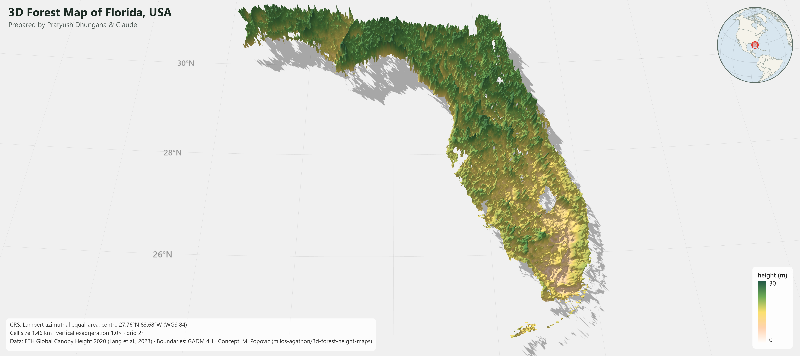

# 3D Forest Height Studio

Make interactive 3D forest-canopy-height maps for **any country or region** on your own computer, with a live
WebGL viewer, publication-style map furniture (lat/long grid, scale bar, CRS, locator globe), and one-click exports.


*Florida, USA, made with the studio.*

## Credit

This project builds on the technique shared by **Milos Popovic, PhD**, who showed how to turn the ETH canopy-height
data into striking 3D maps with R (ggplot2 + rayshader):

- Video tutorial: <https://www.youtube.com/watch?v=4ScYWPMzy6E>
- Original repository: <https://github.com/milos-agathon/3d-forest-height-maps>

The idea of the map style and the workflow is his. This repository does not include his code; it is a separate tool
that applies the same idea to custom regions with an interactive viewer. Please credit his work when you share maps made here.

**Data**
- Canopy height: ETH Zurich *Global Canopy Height 2020* (10 m). Lang, N., Jetz, W., Schindler, K., Wegner, J.D. (2023).
  A high-resolution canopy height model of the Earth. *Nature Ecology & Evolution* 7, 1778-1789.
- Boundaries: [GADM 4.1](https://gadm.org), via the `geodata` R package.

## What it does

A guided, step-by-step workflow (you can go back to any step):

1. **Setup** - checks and installs the R packages it needs.
2. **Region** - pick a country and optional sub-regions; preview the outline and the 3-degree data tiles it touches.
3. **Tiles** - shows tile sizes and free disk space, uses tiles already on disk, or downloads them in the background
   (with a small game to pass the time).
4. **Build** - crops, aggregates, masks and (optionally) reprojects the canopy layer.
5. **Explore** - orbit, zoom, change sun, shadows, height exaggeration, palette, discrete classes with your own colours,
   legend, title, grid, scale bar and more, all in real time.

**Exports**
- **PNG** at 1x / 2x / 4x, including title, legend, grid, scale bar, CRS and credits.
- **Interactive HTML page**: one self-contained file (works offline if you bundle the 3D engine) that you can host on any
  static site, such as GitHub Pages, and embed with an `<iframe>`.
- **GeoTIFF** of the canopy layer.
- **R code tab**: a standalone, path-free R script that reproduces the map, plus a 2D publication map. Edit its settings
  block to run your own experiments outside the app.

## Requirements

- **R** (developed and tested on R 4.6.1). RStudio is optional.
- An internet connection (boundaries, tile downloads, and the 3D engine in the browser).
- Free disk space: each canopy tile is roughly 150-450 MB; the app shows the total before downloading anything.
- A modern browser with WebGL.
- R packages are installed on first launch by the Setup step (`sf`, `terra`, `geodata`, `classInt`, `jsonlite`, `callr`,
  plus `shiny` and `bslib`). On Linux, `sf` and `terra` need the system GDAL, GEOS and PROJ libraries.

## Run it

```r
# from the repository folder
source("run_app.R")        # or, in a terminal:  Rscript run_app.R
```

It opens in your browser at <http://127.0.0.1:4821>.

## Known limitations

- Developed and tested on **Windows** only. The "Browse..." folder button and the free-disk check are Windows-specific
  (they do nothing elsewhere); the rest should work on macOS and Linux but is untested there.
- Very large regions (for example the whole of Russia) mean hundreds of tiles and tens of GB. Start with a state, province or small country.
- Tile downloads rely on ETH Zurich's public file server staying available at the same address.
- Region selection was checked on ten very different places; full layer builds were tested on a smaller set.

## Roadmap

- Custom area-of-interest selection (draw your own region).

## Repository layout

```
run_app.R                         launcher
app/app.R                         the Shiny app (step-by-step workflow)
app/www/viewer.js                 live 3D viewer (three.js): lighting, classes, grid, scale bar, locator
app/www/exporter.js               builds the shareable interactive HTML page
app/www/studio.js, runner.js      tabs / code export glue, and the waiting-room game
app/templates/replicate_template.R  template for the generated R script
R/canopy_functions.R              region, tile and canopy-layer pipeline
R/script_export.R                 generates the standalone R script
```

## License

MIT - see [LICENSE](LICENSE). Data and third-party services keep their own terms (ETH Zurich dataset, GADM, three.js).
