# Getting started with 3D Forest Height Studio

In this tutorial you will make an interactive 3D map of forest canopy height for **Florida, USA**, explore it in real
time, style it, and export it as a picture, as a web page you can share, and as an R script you can keep experimenting
with. The same steps work for any country or region.

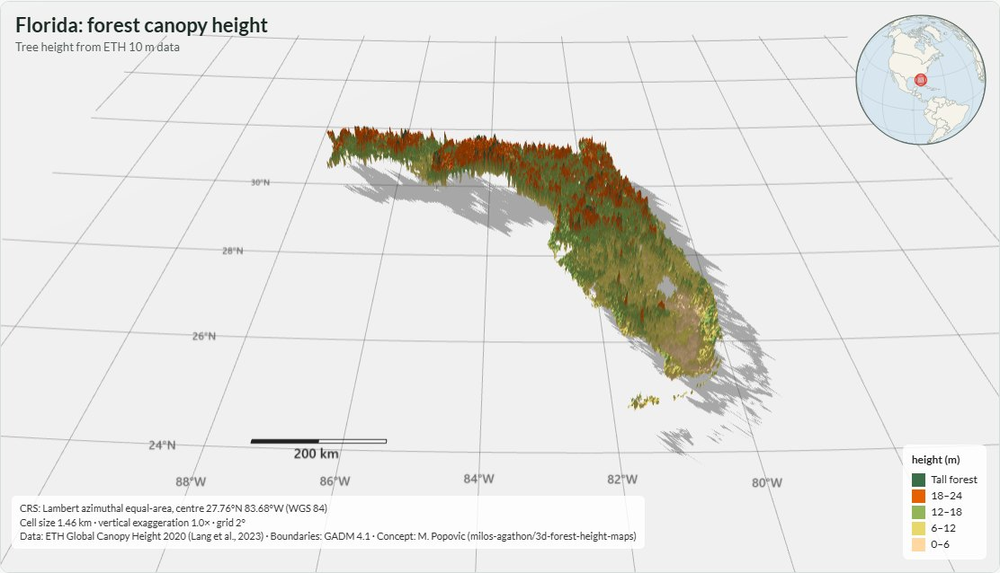

> **Credit.** The 3D forest-height map style comes from
> [Milos Popovic's tutorial](https://www.youtube.com/watch?v=4ScYWPMzy6E)
> ([repository](https://github.com/milos-agathon/3d-forest-height-maps)); this app applies the idea to custom regions with an
> interactive viewer. Canopy data: ETH Zurich Global Canopy Height 2020 (Lang et al., 2023). Boundaries: GADM 4.1.

**How long it takes (Florida, as measured on my Windows PC):** installing about a minute; downloading the 8 tiles
(1.5 GB) depends on your connection; building the layer took about 5 minutes at the default detail. Everything after
that is instant.

---

## Contents

1. [Install and start](#1-install-and-start)
2. [Step 1: Setup](#2-step-1-setup)
3. [Step 2: Choose a region](#3-step-2-choose-a-region)
4. [Step 3: Tiles (data download)](#4-step-3-tiles-data-download)
5. [Step 4: Build the layer](#5-step-4-build-the-layer)
6. [Step 5: Explore and style](#6-step-5-explore-and-style)
7. [Export and share](#7-export-and-share)
8. [Reproduce it in R](#8-reproduce-it-in-r)
9. [Tips and troubleshooting](#9-tips-and-troubleshooting)

---

## 1. Install and start

**Windows (no R needed):** download **3D-Forest-Height-Studio-Setup-x.y.z.exe** from the
[Releases page](https://github.com/pratyush-dh/3d-forest-height-studio/releases/latest) and run it. It installs for your user
only (no administrator rights) and adds a Start menu entry. Windows may show *"Windows protected your PC"* because the
installer is not code-signed yet: choose **More info -> Run anyway**.

Then open **3D Forest Height Studio** from the Start menu. The app opens in its own window.

**macOS / Linux, or if you prefer R:** install [R](https://cran.r-project.org/), download or clone the repository and run

```r
source("run_app.R")      # from the repository folder; opens at http://127.0.0.1:4821
```

The first launch installs the R packages it needs, so it takes a few minutes.

> **Where does my data go?** The installed app keeps downloaded tiles and caches in
> `%LOCALAPPDATA%\3D Forest Height Studio`. When run from source it uses the repository folder.

---

## 2. Step 1: Setup

The app first checks and loads the R packages it relies on (`sf`, `terra`, `geodata`, `classInt`, `jsonlite`,
`callr`). With the installer this takes a second or two, and then moves on by itself.

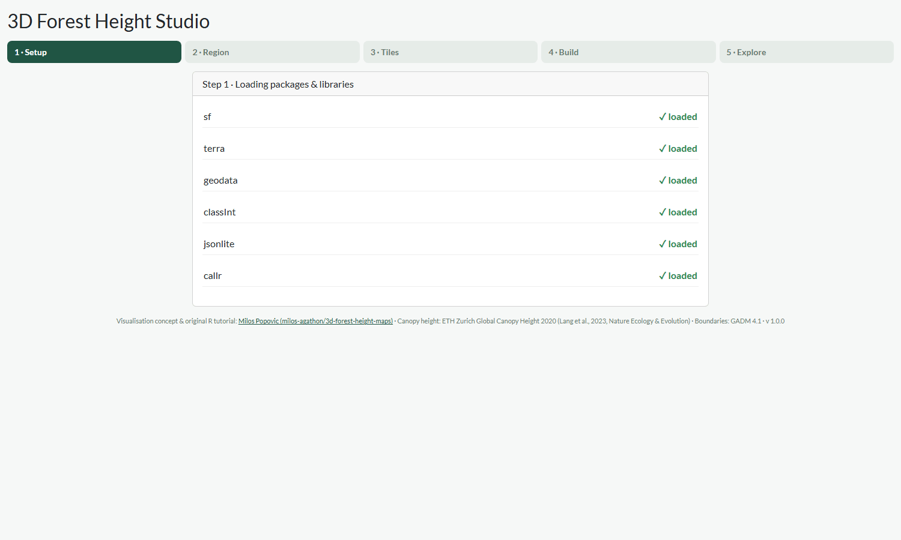

---

## 3. Step 2: Choose a region

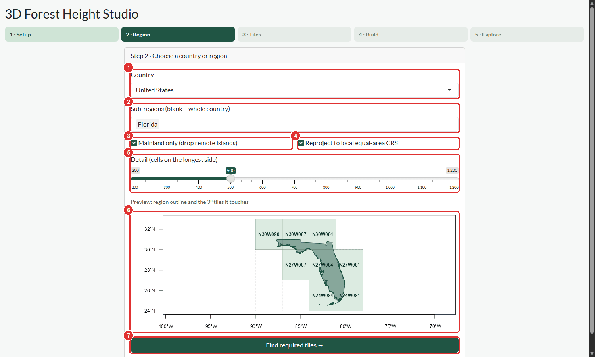

1. **Country**: pick one from the list. Type to search.
2. **Sub-regions**: optionally narrow it down (here: *Florida* within the United States). Leave it blank to map the
   whole country. You can select several.
3. **Mainland only**: drops far-away islands and territories, so you do not download tiles for places that would only
   make your map tiny (for example Alaska and Hawaii when mapping the US). Untick it to keep everything.
4. **Reproject to a local equal-area CRS**: recommended. It centres the map on your region and keeps areas true.
   Untick it to stay in plain longitude/latitude.
5. **Detail**: how many cells the longest side of the map has. Higher is sharper but slower and uses more memory.
   About **200-400** is a quick preview; **500-800** is a good result; above **1000** is for small regions.
6. **Preview**: your region's outline and the 3-degree data tiles it touches. Solid boxes are needed;
   dashed boxes are just the surrounding grid.
7. **Find required tiles**: click when the preview looks right.

---

## 4. Step 3: Tiles (data download)

The canopy data comes as 3 x 3 degree tiles of 150-450 MB each. This step works out exactly which ones you need,
how big they are, and whether they are already on your computer.

### If you already have the tiles

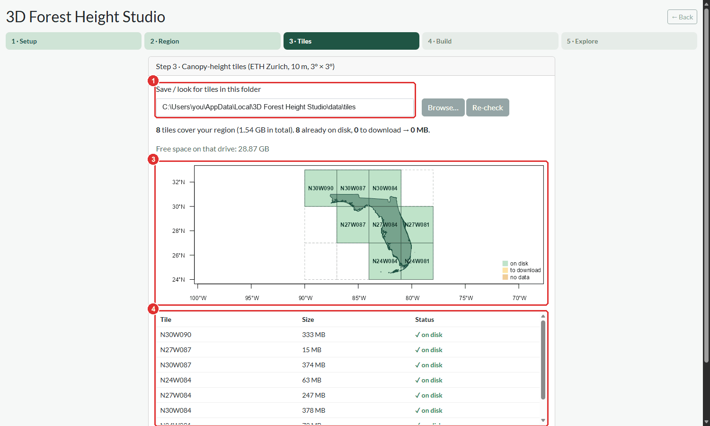

1. **Tile folder**: where the app looks for (and saves) tiles. Use **Browse...** to point at a folder you already have;
   **Re-check** rescans it.
2. **Summary**: how many tiles, their total size, how many are on disk and how many are still to download, plus the
   free space on that drive. It turns red if there is not enough room.
3. **Preview map**: green = on disk, amber = to download, red = the server has no data there (open ocean).
4. **Tile list**: size and status of each tile.
5. **Continue** (below the tile list: scroll down) when everything is green.

### If tiles are missing

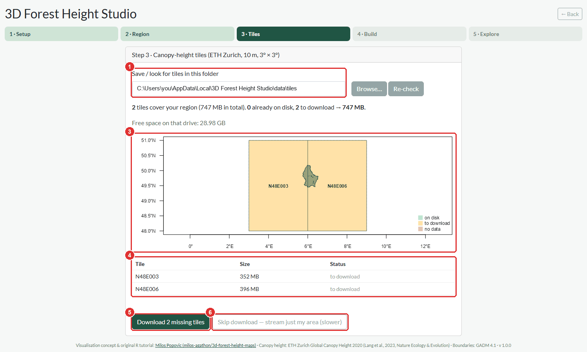

Here the tiles are amber. Your choices:

- **5. Download** the missing tiles (recommended: this is a one-time cost and later runs are fast).
- **6. Skip the download and stream** only your area straight from the server. You keep no big files, but building takes
  longer and needs internet each time.

### While it downloads

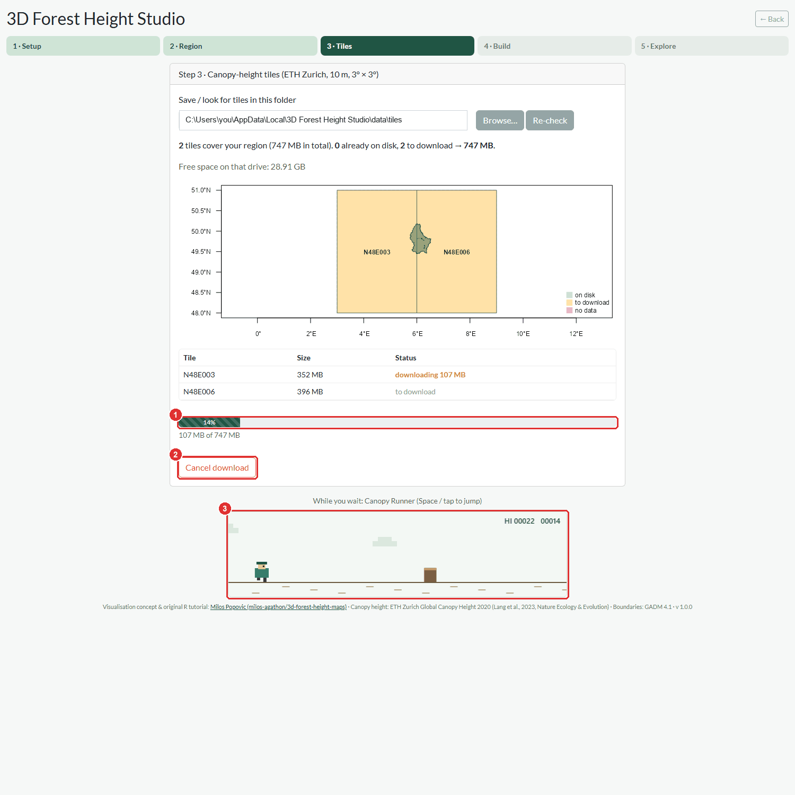

1. **Progress** and the per-tile status update live. The download runs in the background, so the app stays responsive.
2. **Cancel** any time. Partly downloaded files are kept as `.part` and replaced on the next try.
3. Large downloads take a while, so there is a small game, **Canopy Runner**: press **Space** (or tap) to jump the stumps.

---

## 5. Step 4: Build the layer

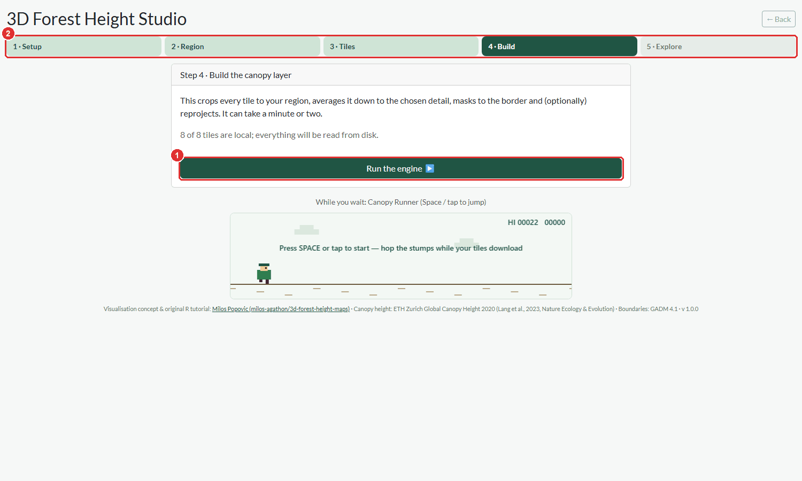

1. **Run the engine** crops every tile to your region, averages it down to the chosen detail, masks it to the border and
   (optionally) reprojects it. For Florida at detail 500 this took about 5 minutes. Finished layers are cached, so asking
   for the same region again is instant.
2. The **step bar** is always clickable: go back to any step you have finished without losing your work (for example
   to change the region or the detail). Changing the region means the layer has to be built again.

---

## 6. Step 5: Explore and style

When the layer is built you land in the viewer. Everything here updates **live**: nothing needs to be re-computed.

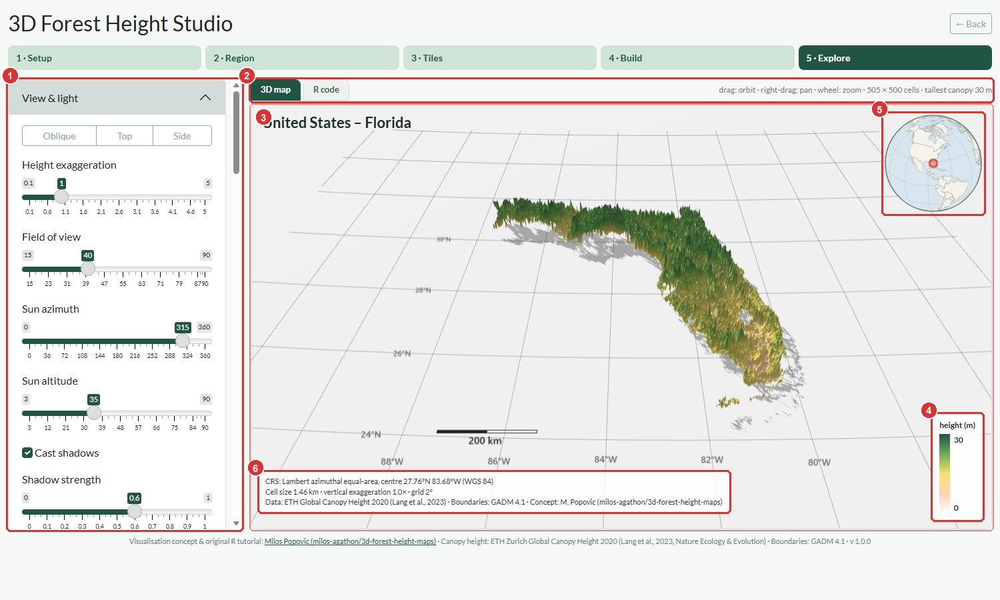

1. **Control panel** (scrolls independently of the map).
2. **Tabs**: *3D map* and *R code* (see [section 8](#8-reproduce-it-in-r)).
3. **The 3D view**: drag to orbit, right-drag to pan, mouse wheel to zoom.
4. **Legend**, 5. **locator globe** showing where your map is, and 6. the **info box** with the map projection, cell
   size, vertical exaggeration and credits.

### View and light

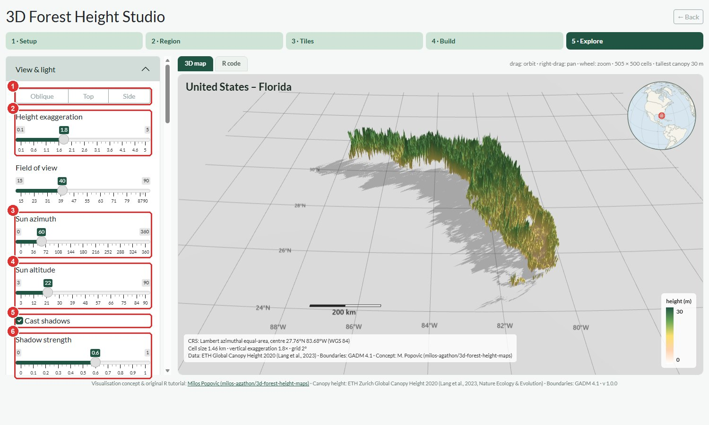

1. **Camera presets**: Oblique, Top and Side.
2. **Height exaggeration**: how tall the canopy looks.
3. **Sun direction** and 4. **Sun height**: move the light to change what the shadows reveal.
5. **Cast shadows** on/off and 6. **Shadow strength**.

There is also **Field of view** and **Auto-rotate** in the same panel.

### Colours and classes

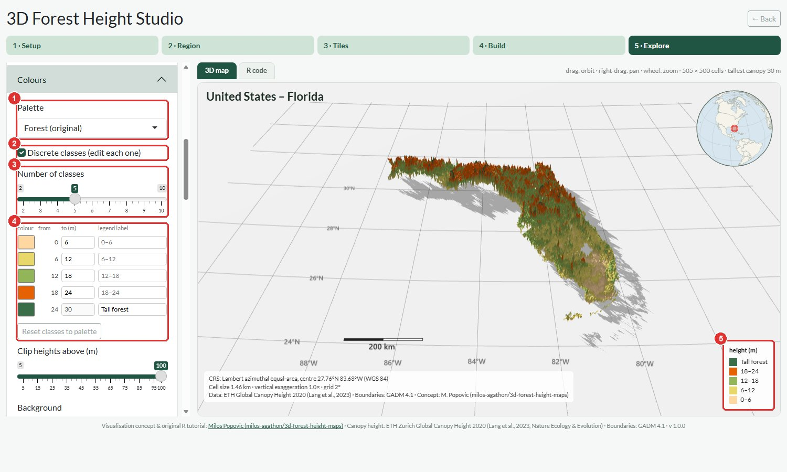

1. Choose a **palette**.
2. Tick **Discrete classes** to colour by ranges instead of a smooth ramp.
3. Set the **number of classes** (2-10).
4. For each class you can change its **colour**, its **upper limit** in metres, and the **text shown in the legend**
   (here the top class is renamed *Tall forest* and one class was recoloured orange).
   **Reset classes to palette** undoes your edits.
5. The legend follows your changes immediately.

You can also clip very tall values, change the background and toggle the ground plane.

### Grid, scale and context

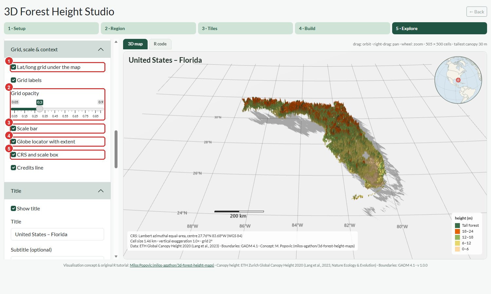

These make the map suitable for reports and papers.

1. A faint **latitude/longitude grid** sits under the terrain, with degree labels, and 2. an **opacity** control.
3. A **scale bar** on the ground, 4. a **globe locator** with your extent marked in red, and 5. a **CRS and scale box**
   stating the projection, cell size and vertical exaggeration. There is also a switch for the credits line.

### Title and legend

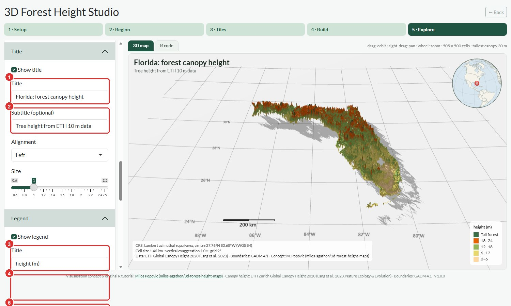

1. **Title** and 2. **subtitle** (the title starts as your region's name), 3. **legend title**, 4. **legend position**
   and 5. **legend size** (plus the number of decimals in the labels). Title, legend, grid, scale and credits are all
   drawn into your exports.

---

## 7. Export and share

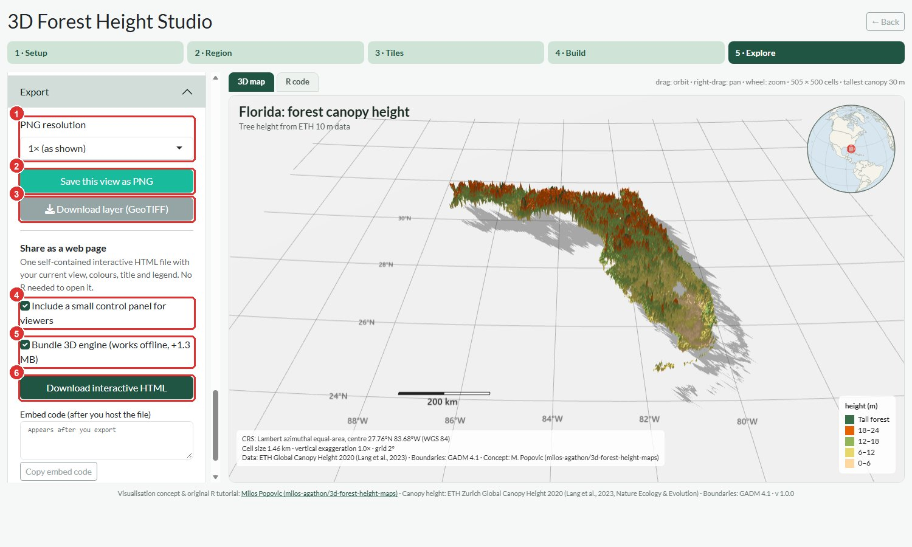

1. Pick a **PNG resolution** (1x as shown, or 2x / 4x for print).
2. **Save this view as PNG** saves exactly what you see, including title, legend, grid, scale bar, locator and credits.
3. **Download layer (GeoTIFF)** gives you the canopy-height raster for use in GIS or your own analysis.

### Share it as a web page

4. Tick **Include a small control panel** if viewers should be able to change the sun, exaggeration and view.
5. Tick **Bundle 3D engine** to make the page work completely offline (adds about 1.3 MB).
6. **Download interactive HTML** creates **one self-contained file** with your data, colours, title and camera. It does
   not need R or this app to open.

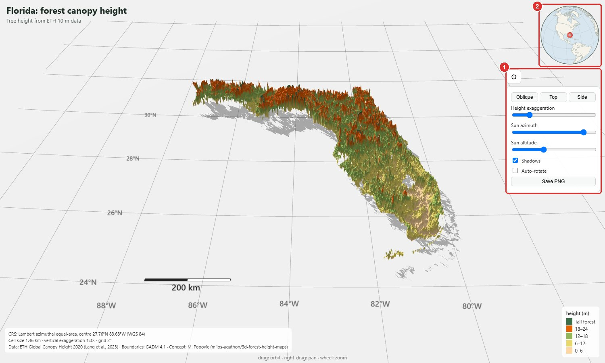

*The exported page, with the optional control panel (1) and the locator, grid, scale bar and credits (2).*

Put the file on any static host (for example [GitHub Pages](https://pages.github.com/) or Netlify Drop) and embed it in
another page with the `<iframe>` snippet the app gives you.

---

## 8. Reproduce it in R

Open the **R code** tab to get a complete, standalone R script for the map you are looking at.

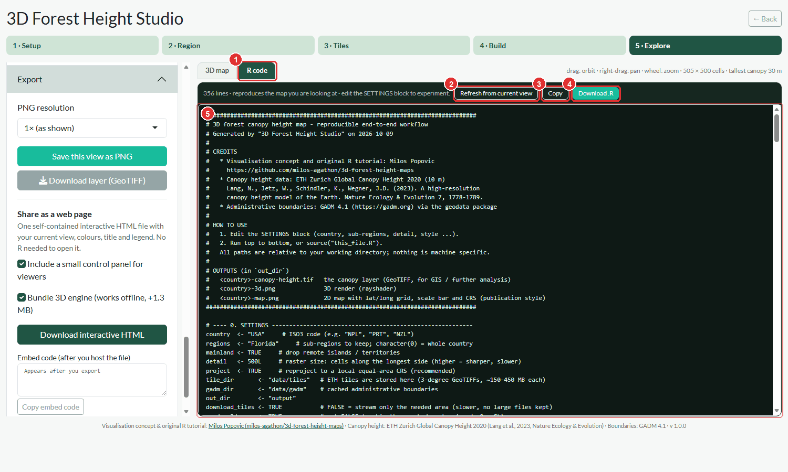

1. The **R code** tab. 2. **Refresh from current view** regenerates the script after you change settings. 3. **Copy** or
4. **Download .R**. 5. The script itself.

The script has **no machine-specific paths**. Edit the settings block at the top (country, sub-regions, detail, style)
and run it in R or RStudio to make your own variations. It does the whole workflow:

| Output | What it is |
|---|---|
| `<country>-canopy-height.tif` | the canopy layer (GeoTIFF) |
| `<country>-3d.png` | a 3D render with `rayshader` |
| `<country>-map.png` | a 2D publication map with lat/long grid, scale bar, north arrow and CRS |

---

## 9. Tips and troubleshooting

| Problem | What to do |
|---|---|
| Windows says "Windows protected your PC" | The installer is not code-signed yet. **More info -> Run anyway.** |
| "Not enough free space" in Step 3 | Choose another folder with **Browse...**, or use **Skip download and stream**. |
| The region looks too small, or a distant island is included | Toggle **Mainland only** in Step 2. |
| Building is slow or the viewer is sluggish | Lower **Detail** (try 300-400) or pick a smaller region. |
| Very large regions (Russia, Brazil...) need hundreds of tiles | Start with a state, province or small country. The app warns you when a download is very large. |
| A tile fails to download | Press **Re-check** and download again. If it persists, the data server may be temporarily unavailable. |
| Nothing happens when you press *Find required tiles* | The region outline was still loading. Wait a moment and press it again. |
| I closed the window | The installed app stops itself about 10 seconds after the last window closes. Just start it again from the Start menu. (When run from source, stop it with Esc / the Stop button in R.) |
| I want my data somewhere else | In Step 3, point the tile folder at any location. Other cached files stay in the data folder listed in [section 1](#1-install-and-start). |

**Found a problem or have an idea?** Please open an issue on
[GitHub](https://github.com/pratyush-dh/3d-forest-height-studio/issues).

---

*Maps made with 3D Forest Height Studio. Concept: Milos Popovic. Data: ETH Zurich Global Canopy Height 2020 (Lang et al., 2023)
and GADM 4.1.*
